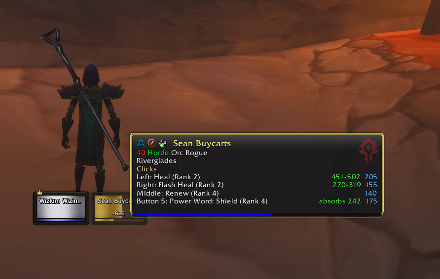
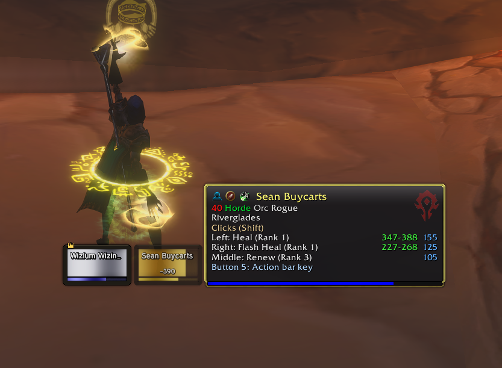
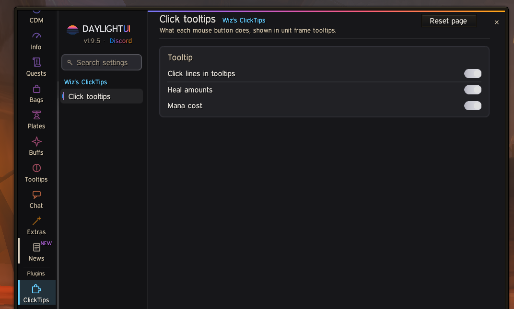
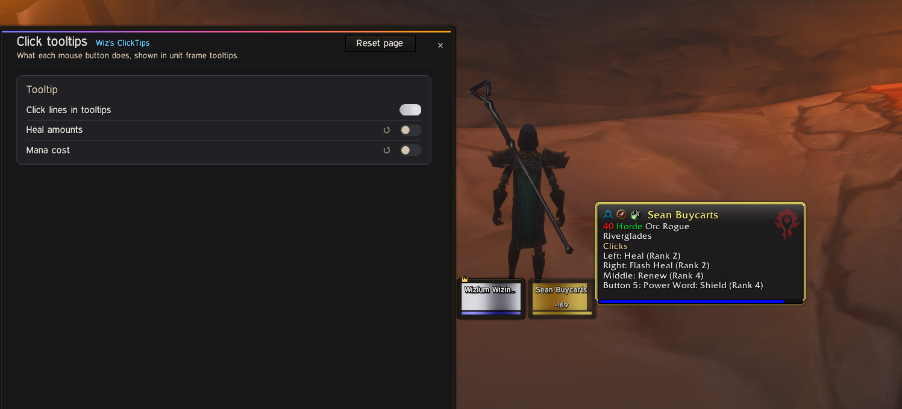

# Wiz's ClickTips (DaylightUI Plugin)

**Your click-cast spells, right in the tooltip.**

A plugin for **DaylightUI** on **WoW: Forever** (tested with DaylightUI 2.0). Hover a party
or raid frame to see the spell each mouse button casts through DaylightUI's click-casting,
HealBot-style. Hold Shift, Ctrl or Alt and the list switches to that modifier's spells
instantly:

Hold a modifier and the lines switch to that set, here Shift for lower ranks:

- One line per mouse button, for the Shift / Ctrl / Alt you're holding right now. Press or
  release a modifier and the lines change.
- Or turn on **Show all modifiers** to see every click you've bound at once, grouped under
  its modifier (Shift, Ctrl, Ctrl · Shift...), without holding any keys. Only sets with
  something bound show, and holding a modifier brightens its group and turns its name green.
- Spell icons, and colors: **white** ready, **orange** out of range, **red** no mana or on
  cooldown, **grey** invalid target (like a heal on an enemy) or can't be cast right now.
  Every color can be changed.
- Right side: the heal or absorb amount (green), the mana cost (blue), and if you like, how
  many casts your mana has left (x12).
- Uses your bindings from DaylightUI's own click-casting (Unit Frames > Click-casting). It
  only reads them: nothing is changed, and it's safe in combat.

## Install
1. Install DaylightUI first.
2. Copy the `DaylightClickTips` folder into `World of Warcraft/_forever_/Interface/AddOns/`.
3. Enable **Wiz's ClickTips (DaylightUI Plugin)** on the character screen.

## Options
In `/dui`: the **ClickTips** plugin page, or **Unit Frames > Click-casting > Tooltips**.

- **Tooltip:** click lines, spell icons, heal amounts, mana cost, casts left.
- **Lines:** spell ranks, short button names (L / R / M / B4 / B5), the "Clicks" heading,
  hide DaylightUI's default Left = Target / Right = Unit menu (a click you set yourself,
  like Ctrl + Left = Target, still shows), show all modifiers (with or without amounts
  and cost), only while holding a modifier, hide in combat.
- **Show on:** party, raid, party pets, player, target, focus, other frames, and enemies
  (off by default, so your target frame shows the lines for friends only).
- **Colors:** ready, out of range, not enough mana, on cooldown, invalid target, heal amount,
  mana cost, held modifier.

Or type `/clicktips` for the list of switches, then `/clicktips <word>` to flip one:
`tip`, `amounts`, `cost`, `casts`, `icons`, `rank`, `short`, `header`, `defaults`, `hold`,
`combat`, `all`.

Settings are account-wide.

## Notes
- Heal amounts are read from the spell's description, which works on English clients.
  On other languages the amount is left out; everything else works.
- Only DaylightUI's unit frames get the lines (party, raid, party pets, player, target, focus).
- With DaylightUI's **Rich** tooltips, a fight shows a small "Fight pill" instead of the full
  card by default (holding Shift shows the card), so the click lines are hidden too. To see
  them in combat, set **Fight pill** to **Never** in DaylightUI's Tooltips options.

## License
MIT (see `LICENSE`). Made by WizardLumps. Not affiliated with DaylightUI; it needs
DaylightUI installed and holds none of its code or art.

## Changelog
- v1.2.3 - New "Show all modifiers" switch (Lines), off by default: every click you've
  bound, grouped by modifier (Shift, Ctrl, Ctrl · Shift...), without holding any keys. Only
  sets with something bound show; holding a modifier keeps its group bright with its name
  in green ("Held modifier" under Colors) and dims the rest. "Amounts in the full list"
  adds heal amounts and mana cost there too (off by default). `/clicktips all` flips it.
  An "Action bar key" click (like a Mouse 5 macro) no longer repeats under every modifier.
- v1.1.1 - New "Enemies too" switch under Show on, off by default: no click lines on enemy
  units, like the mob you're targeting. Release notes on CurseForge now come from CHANGELOG.md.
- v1.1.0 - Its own icon in the /dui sidebar. New settings: spell icons, casts left, spell ranks, short button names, the
  "Clicks" heading, hide default clicks, only while holding a modifier, hide in combat,
  which frames show the lines, and every color. Spells that can't go on the hovered unit
  (a heal on an enemy) show grey "invalid target". No more flicker: the tooltip only
  refills when a line changes. Tested with DaylightUI 2.0.
- v1.0.2 - CurseForge project ID in the TOC, and packaging settings (.pkgmeta) for
  CurseForge's automatic releases.
- v1.0.1 - Its own icon: a tooltip bubble with a heal cross.
- v1.0.0 - First release: click lines in unit frame tooltips, heal amounts, mana cost,
  options in /dui and /clicktips.
